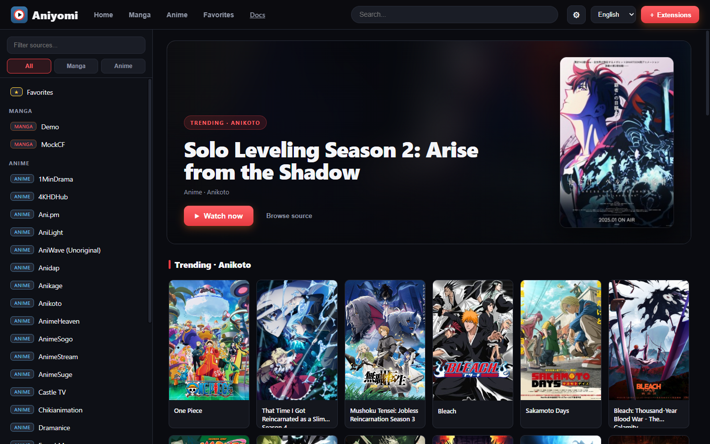

# Aniyomi Desktop

Aniyomi, running on Windows. No emulator, no phone, no WSA.



The Android app is gone from this picture: the extension engine (Aniyomi's
`extensions-lib` + source API) runs as plain Java on the JVM, loads the real
Aniyomi extension APKs, converts their bytecode with `dex2jar`, and serves the
catalogue, episode list and video streams to a local web UI in a standalone app
window.

```
Start Aniyomi.bat     -> supervisor + anime engine on :8790 + manga engine on :4567
Stop Aniyomi.bat      -> stops all three
Aniyomi.lnk           -> desktop shortcut to the above
```

**State of this build:** two engines, one window.

- **Anime** (`127.0.0.1:8790`, miwayomi): 373 Aniyomi extensions collected from 12
  repos, 502 installed incl. the NSFW sets; 486 sources were tested end to end
  and **82 play** (catalogue → episodes → real video URL). The rest are dead
  hosts, Cloudflare walls, or extensions that need a real `WebView` for a token.
  mpv hand-off carries the extension's subtitles.
- **Manga** (`127.0.0.1:4567`, Suwayomi): **the miwayomi engine cannot run
  Tachiyomi manga extensions** — dex→jar conversion mangles their typed arrays
  and every source dies with `ArrayStoreException: java.lang.Object` inside
  `getClient`. Suwayomi runs them natively instead: 1716 extensions available,
  600+ installed (en/fr), ~560 sources, verified down to the page image.
  The **Manga** tab is our own UI (source picker, poster grid, chapter list,
  reader) talking to that engine over GraphQL — no second window, no foreign UI.


## What is inside

| Piece | Role |
|---|---|
| `app/miwayomi-all.jar` | the anime engine: extension loader (dex2jar + child-first classloader), Aniyomi source API ported to JVM, Ktor server, web UI |
| `app/suwayomi.jar` | the manga engine: Suwayomi (Tachidesk) server, runs Tachiyomi/Mihon extensions natively |
| `data-manga/` | Suwayomi data: its H2 DB, downloaded extensions, settings |
| `tools/jdk-21.0.13+9` | bundled JRE — nothing to install |
| `data/` | installed extensions (`.apk` + converted `.jar`), prefs, SQLite (favourites, watch history, repos) |
| `data/extensions/` | the extension APKs actually loaded |
| `scripts/source_health.py` | installs every extension of a repo and tests catalogue → details → episodes → videos |
| `data/source-tests.jsonl` | the last health run, one line per source |

## How sources work

Sources are Aniyomi extension APKs, the same files the phone app installs.
Two live repositories are pre-registered:

- `salmanbappi/extensions-repo` — the big Anikku/Aniyomi set
- `aniyomi-addons/anime-extensions-repo` — smaller set with French sources

Add another in the UI: **＋ Extensions → paste `index.min.json` URL → Load →
Install**. Extension install/download is instant; it appears in the sidebar as a
source right away.

## Manga (Suwayomi)

Manga extensions are Tachiyomi/Mihon APKs, not Aniyomi ones, and the miwayomi
engine breaks them: after `dex2jar` their typed arrays come out as `Object[]`,
so the first API call throws `ArrayStoreException: java.lang.Object` inside the
extension's `getClient`. That hit **all 1209 manga sources** — installing more
never helped. They were uninstalled from the anime engine and manga now runs on
Suwayomi, which executes the same APKs natively:

- extension store: `keiyoushi/extensions` (1716 manga extensions)
- installed through GraphQL (`scripts/install_manga_suwayomi.py en fr`), 560+
  sources; chapter pages served as real JPEGs
- the **Manga** tab renders our own views (`goManga`, `muPopular`, `muOpen`,
  `muRead` in `app.js`): source picker, poster grid, search, chapter list and a
  full-screen reader — the manga engine only supplies JSON

Suwayomi keeps its own database in `data-manga/`; the watchdog restarts it on
port 4567 if it dies.

## Engine patches in this build

- `/anime/{id}/videos` and `/hosters` now rebuild the chosen episode with its
  name and number (`AnimeRoutes.kt`, `ApiHelpers.kt`). Upstream sent a URL-only
  episode, and Aniyomi's `SEpisode.name` is `lateinit` — every extension that
  reads `episode.name` (most of them) died with
  `UninitializedPropertyAccessException`, so the player was always empty.
- `/details`, `/episodes` and `/seasons` do the same for `SAnime.title`
  (`animeFromQuery`), which fixed 4 more sources and removed the
  `lateinit property title` 500s.
- `hls.js` and `dash.js` are bundled in `webui/vendor/` instead of a jsDelivr
  CDN, so playback works offline / behind a blocked CDN.
- UI: new home hero + "Trending" row from a real catalogue, poster hover
  states, French translation, Aniyomi branding.
- `scripts/watchdog.ps1` supervises the engine and restarts it if the JVM dies
  (see below).

## The player

Custom player, not browser chrome:

- seek bar with drag, buffered range and hover time tooltip · play/pause · ±10 s ·
  next episode · volume · speed (0.5×–2×) · subtitles · source picker · fullscreen
- auto-hiding controls, buffering spinner, resume toast, keyboard: `space` play,
  `←/→` seek, `↑/↓` volume, `m` mute, `n` next, `f` fullscreen, `esc` close
- **▣ opens the stream in mpv** (0.39, installed) through the same local proxy, so
  headers/Referer still work — the desktop-app feel without losing HLS support
- subtitles come from the extension's `subtitleTracks`, proxied same-origin

## Why `-Xverify:none`

`dex2jar` output for some extension classes has missing stack-map frames, and
the JVM verifier rejects them (`VerifyError: Expecting a stackmap frame...`).
The launcher therefore starts the JVM with `-Xverify:none`. The alternative is
recomputing frames for every class at install time — not worth the risk for
third-party bytecode that is already untrusted either way.

## Known limits

- **The JVM can still die on a bad extension.** `dex2jar` sometimes emits a
  method HotSpot refuses to compile (`Illegal class file … Try running with
  -Xverify:all`), which is a native crash, not an exception. Four extensions did
  that during testing and were removed; the watchdog restarts the engine in
  ~15 s if another one turns up, and the page needs a refresh (Ctrl+R).
- **Cloudflare-protected sources** (Manganato-class sites) need FlareSolverr on
  `127.0.0.1:8191`; without it those sources answer with a challenge error.
  The launcher runs with FlareSolverr disabled (`-f ""`).
- 404 of the 486 sources tested failed: dead hosts, unreachable networks,
  Cloudflare, or extensions that need a real `WebView` to extract a token (no
  browser inside a headless JVM). They were uninstalled; `data/source-tests.jsonl`
  keeps the evidence and **＋ Extensions** reinstalls any of them in seconds.

## This repository

| Path | What |
|---|---|
| `engine/` | the miwayomi source as built here — the patches listed above (player routes, `ApiHelpers`, `MangaRoutes`, `JarFixer`) plus the whole UI in `server/src/main/resources/webui/` (home, player, Manga tab, fr/en/es) |
| `app/miwayomi-all.jar` | the built anime engine (99 MiB) — the file `Start Aniyomi.bat` runs |
| `scripts/` | repo collector, extension installers, source harness, prune, watchdog |
| `docs/`, `assets/` | screenshots and notes |

Not committed, all runtime state:

- `data/` — installed extension APKs/converted JARs, prefs, SQLite (favourites,
  history), test logs
- `window-profile/` — the Brave profile the `--app` window uses; it holds live
  cookies, so it never goes in git
- `tools/` — the bundled JDK 21 (~526 MB)
- `app/suwayomi.jar` — 174 MiB, past GitHub's file limit; take it from the
  [Suwayomi releases](https://github.com/Suwayomi/Suwayomi-Server/releases)

From a fresh clone (JDK 21, both engines running):

```bash
python scripts/collect_repos.py      # -> data/ext-candidates-all.json
python scripts/install_all.py        # anime extensions
python scripts/install_manga_suwayomi.py en fr
"Start Aniyomi.bat"
```

Rebuild the engine after changing `engine/`: `cd engine && ./gradlew shadowJar`,
then copy `server/build/libs/*-all.jar` over `app/miwayomi-all.jar`.

## Attribution

Engine: [miwayomi](https://github.com/miwayomi/miwayomi) (Apache-2.0), which
ports the Aniyomi/Mihon source API to the JVM and reuses AndroidCompat
(Apache-2.0, originally TachiWeb/`null-dev`). Aniyomi itself is
Apache-2.0 (`aniyomiorg/aniyomi`).

This build is an unaffiliated desktop port. It ships no content: every
catalogue, stream and image comes from whatever third-party extension the user
installs, and those extensions are responsible for what they do.
